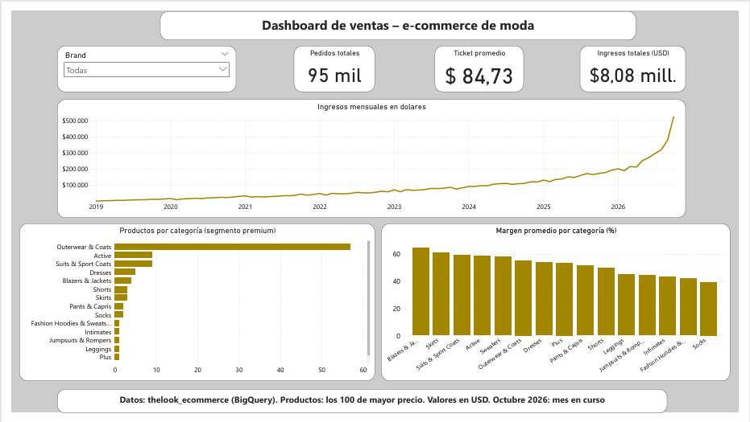

# Dashboard de ventas – e-commerce de moda

Proyecto de análisis de datos de punta a punta: extracción con **SQL (BigQuery)**, limpieza con **Python (pandas)** y visualización en **Power BI**.

## Problema de negocio

Una tienda online de moda quiere responder tres preguntas:

1. ¿Cómo evolucionaron los ingresos y los pedidos a lo largo del tiempo?
2. ¿El crecimiento viene de vender más pedidos o de pedidos más caros?
3. ¿Qué categorías concentran el catálogo premium y cuáles dejan más margen?

## Herramientas

- **SQL (Google BigQuery):** consultas sobre el dataset público `thelook_ecommerce`.
- **Python (pandas):** revisión de calidad de datos, limpieza y cálculo de columnas nuevas.
- **Power BI:** modelo de datos, medida DAX para el ticket promedio y dashboard interactivo.

## Qué hice

1. Extraje con SQL los 100 productos de mayor precio y las ventas mensuales (excluyendo pedidos cancelados y devueltos).
2. Revisé la calidad de los datos con Python: sin vacíos, sin duplicados, sin precios en cero ni costos mayores al precio.
3. Calculé el margen (en dinero y en porcentaje) de cada producto y el ticket promedio y el crecimiento de cada mes.
4. Resolví un problema de configuración regional (punto decimal) al cargar los datos en Power BI.
5. Creé una medida DAX para el ticket promedio (ingresos totales / pedidos totales), porque promediar promedios mensuales distorsiona el resultado.
6. Armé el dashboard con tarjetas de KPIs, filtro por marca y tres gráficos.

## Hallazgos

- **Crecimiento sostenido:** el ingreso promedio mensual pasó de unos **USD 5,7 mil en 2019 a unos USD 154 mil en 2025**.
- **El crecimiento viene del volumen:** el ticket promedio anual se mantuvo estable, entre unos USD 82 y 86, mientras que los pedidos anuales pasaron de 828 (2019) a 22.090 (2025).
- **Catálogo premium concentrado:** el **57%** de los 100 productos más caros son abrigos (*Outerwear & Coats*), con un margen promedio de 55,4%.
- **Márgenes por categoría** (solo categorías con 3 o más productos): *Blazers & Jackets* lidera con 64,6% y *Shorts* tiene el más bajo con 49,7%.
- **Totales del período analizado:** USD 8,08 millones en ingresos, 95.421 pedidos y un ticket promedio de USD 84,73.

## Limitaciones

- Los productos analizados son los **100 de mayor precio** (segmento premium), no todo el catálogo.
- **Octubre de 2026** es un mes en curso y puede estar incompleto.
- Las categorías con 1 o 2 productos no son representativas: su margen "promedio" es el de uno o dos productos.
- Es un dataset público de ejemplo, no datos reales de una empresa.

## Estructura del repositorio

├── 01_limpieza_productos.py     # limpieza y cálculo de margen de productos
├── 02_ventas_mensuales.py       # limpieza y métricas de ventas mensuales
├── productos.csv                # datos originales (BigQuery)
├── productos_limpio.csv         # datos limpios, con margen
├── ventas_mensuales.csv         # datos originales (BigQuery)
├── ventas_mensuales_limpio.csv  # datos limpios, con ticket promedio y crecimiento
├── dashboard de ventas.pbix     # dashboard de Power BI
├── *.png                        # capturas del proceso y del dashboard
└── sql/                         # consultas usadas en BigQuery

## Cómo reproducirlo

1. Ejecutá las consultas de la carpeta `sql/` en BigQuery y descargá los resultados como CSV.
2. Guardá los CSV como `productos.csv` y `ventas_mensuales.csv` junto a los scripts.
3. Ejecutá `01_limpieza_productos.py` y `02_ventas_mensuales.py` (requieren `pandas`).
4. Abrí `dashboard_ventas.pbix` en Power BI Desktop.

## Próximos pasos

- Sumar análisis de clientes (retención y recompra) uniendo más tablas con SQL.
- Modelar los datos con dbt y sumar un análisis de experimento A/B.
